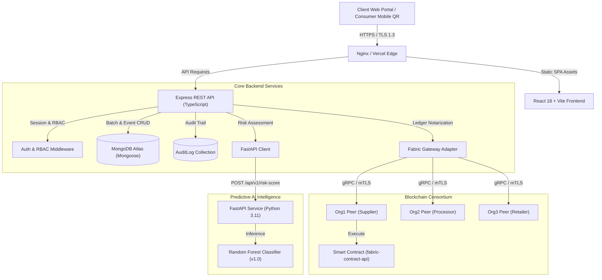

# SecureChainFlow

> **Blockchain and AI Integrated Platform for Secure and Transparent Supply Chain Management**

SecureChainFlow is an enterprise-grade supply chain provenance platform combining **Hyperledger Fabric v2.5** distributed ledger notarization, **scikit-learn** predictive anomaly detection, and instant public consumer verification via **QR codes**.

---

## 🏛 System Architecture



---

## ⚡ Technology Stack

| Layer | Technologies |
| :--- | :--- |
| **Frontend** | React 18, Vite 6, TypeScript 5.7, Tailwind CSS 3.4, Lucide Icons, QR Code Generator |
| **Backend API** | Node.js 22, Express 4, TypeScript 5.7, Zod Validation, JWT, bcrypt, Helmet, Express Rate Limit |
| **Database** | MongoDB Atlas (Mongoose 8) with embedded In-Memory MongoDB for local development |
| **Blockchain** | Hyperledger Fabric v2.5 LTS, Node.js Smart Contract (`fabric-contract-api`), Gateway SDK |
| **AI/ML Service** | Python 3.11+, FastAPI, scikit-learn 1.6, Pandas 2.2, NumPy 2.2, Joblib |
| **Testing** | Jest 29, Supertest 7, Pytest 9, MongoMemoryServer 10 |
| **Deployment** | Docker & Docker Compose, Render (`render.yaml`), Vercel (`vercel.json`), Nginx |

---

## 👥 Consortium Roles & State Machine

SecureChainFlow enforces strict server-side Role-Based Access Control (RBAC):

```
+---------------------------------------------------------------------------------------+
|  [SUPPLIER]           -> Register Product, Register Batch, Commit REGISTERED          |
|  [PROCESSOR]          -> Quality Inspection, Commit QUALITY_CHECKED, Process Batch   |
|  [TRANSPORTER]        -> Dispatch Logistics, Commit DISPATCHED, IN_TRANSIT telemetry |
|  [WAREHOUSE]          -> Inbound Receipt, Commit RECEIVED, STORED environmental logs |
|  [RETAILER]           -> Retail Placement, Commit DELIVERED handover                  |
|  [REGULATOR / AUDIT]  -> Cross-Consortium AI Risk Audit, Recall Flagging, Compliance |
|  [CONSUMER]           -> Public QR Genealogy Scan (Zero-auth, zero privacy leakage)  |
+---------------------------------------------------------------------------------------+
```

### Batch State Transition Matrix
$$\text{REGISTERED} \longrightarrow \text{IN\_PROCESSING} \longrightarrow \text{QUALITY\_APPROVED} \longrightarrow \text{IN\_TRANSIT} \longrightarrow \text{STORED} \longrightarrow \text{AVAILABLE\_FOR\_SALE} \longrightarrow \text{DELIVERED}$$
*(Emergency recall to `RECALLED` permitted from any state by authorized Roles).*

---

## 🚀 Quickstart & Local Setup

### Prerequisites
* **Node.js:** v18+ (tested on Node.js v22)
* **Python:** v3.10+ (for AI service, tested on Python 3.14 / 3.11)
* **npm:** v9+

### 1. Clone & Configure Environment
```bash
cp .env.example .env
cp backend/.env.example backend/.env
cp frontend/.env.example frontend/.env
```

### 2. Install Dependencies
```bash
# Install root orchestration & backend dependencies
npm install
npm --prefix backend install

# Install frontend dependencies
npm --prefix frontend install

# Install AI service virtual environment & packages
cd ai-service
python -m venv .venv
# Windows:
.venv\Scripts\activate
# Linux/macOS:
source .venv/bin/activate
pip install -r requirements.txt
cd ..
```

### 3. Run Development Services
```bash
# Terminal 1: Run Backend API (Port 5000 with automatic in-memory MongoDB)
npm --prefix backend run dev

# Terminal 2: Run Frontend Web Application (http://localhost:5173)
npm --prefix frontend run dev

# Terminal 3: Run AI Quality Inference Service (Port 8000)
cd ai-service
.venv\Scripts\uvicorn app.main:app --host 127.0.0.1 --port 8000 --reload
```

---

## 🐳 Docker Compose (Single-Command Run)

To start MongoDB, Backend, AI Service, and Frontend simultaneously:

```bash
docker-compose up --build -d
```

| Service | Port | URL |
| :--- | :--- | :--- |
| **Frontend Portal** | `5173` | http://localhost:5173 |
| **Backend REST API** | `5000` | http://localhost:5000/api/v1/health |
| **AI Inference Service** | `8000` | http://localhost:8000/health |
| **MongoDB Database** | `27017` | `mongodb://localhost:27017/securechainflow` |

---

## 🧪 Automated Testing & Verification Suite

All 87 automated tests run without external network dependencies:

```bash
# 1. Run Backend Unit & Integration Tests (73 tests)
npm run test:backend

# 2. Run Hyperledger Fabric Smart Contract Unit Tests (8 tests)
npm run test:chaincode

# 3. Run AI Service Unit & Inference Tests (6 tests)
npm run test:ai

# 4. Verify Production Builds
npm run build:backend
npm run build:frontend
```

### Current Verification Metrics
* **Backend Test Suite:** 8 test suites, 73/73 tests passing (`PASS`).
* **Smart Contract Test Suite:** 1 test suite, 8/8 tests passing (`PASS`).
* **AI Service Test Suite:** 1 test suite, 6/6 tests passing (`PASS`).
* **Total Automated Tests:** **87 passing automated tests** (100% pass rate).

---

## 📖 Primary API Endpoints

### Public Consumer Verification
* `GET /api/v1/verify/:token`: Returns sanitized chronological batch timeline, origin details, custodian transitions, and cryptographic SHA-256 integrity score. Unauthenticated; zero Mongo ID or password leakage.

### Authentication & RBAC
* `POST /api/v1/auth/register`: Register user with consortium organization.
* `POST /api/v1/auth/login`: Authenticate and receive signed JWT.
* `GET /api/v1/auth/me`: Get current authenticated user profile and permissions.

### Products & Batches
* `POST /api/v1/products`: Create product template (SUPPLIER/ADMIN only).
* `GET /api/v1/products`: List product templates with pagination.
* `POST /api/v1/batches`: Register new batch and genesis payload hash (SUPPLIER/ADMIN only).
* `GET /api/v1/batches/:id`: Retrieve batch details with dynamic QR data URL.

### Supply Chain Custody Events
* `POST /api/v1/batches/:batchId/events`: Log custody transition and environmental telemetry. Commits to Fabric ledger and logs immutable audit trail.
* `GET /api/v1/batches/:batchId/events`: Chronological event trail.

### Analytics & AI Quality Risk
* `GET /api/v1/analytics/summary`: Real-time consortium KPIs (batches, events, commit rate, recent event feed).
* `GET /api/v1/analytics/export?type=batches|events`: Download sanitized CSV report (rate-limited, audit-logged).
* `GET /api/v1/analytics/risk?batchId=...`: Scikit-learn AI continuous risk score (0–100) with heuristic fallback.

---

## 🔒 Security & Data Integrity Compliance

* **Cryptographic Truthfulness:** The platform never fabricates blockchain transactions. When connected to mock/sandbox infrastructure, the system transparently tags transactions as `LOCAL_DEMO`.
* **Zero Stack-Trace Leakage:** Centralized error handling sanitizes all errors; stack traces are never sent in client HTTP responses.
* **Rate Limiting:** Protects `/auth` (brute-force defense), `/verify` (scraping defense), and `/export` (resource exhaustion defense).

For cloud deployment details on Render, Vercel, and MongoDB Atlas, refer to [DEPLOYMENT.md](file:///e:/Major%20Project/DEPLOYMENT.md).

---

## 📄 License
MIT License. Built according to the SecureChainFlow Master Blueprint specification.
